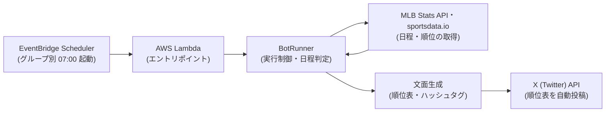

# MLB bot

メジャーリーグベースボール（MLB）の順位表をX（旧Twitter）へ自動投稿する .NET 製のボットです。  
- 投稿先アカウント: [@MLBbot2](https://twitter.com/MLBbot2)

## 概要とアーキテクチャ

AWS EventBridge Scheduler が、East / Central / West の各グループの代表タイムゾーンの朝 07:00 に AWS Lambda を起動し、ア・リーグとナ・リーグの該当地区の順位表を投稿します。文面に表示する日付（各グループの代表タイムゾーンでの実行日の前日）が8月以降の場合は、West の実行でワイルドカード順位もあわせて投稿します。地区優勝が確定したチームには勝敗の後に `🏆`、ワイルドカード進出が確定したチームには `✅` を順位行に表示します。ワイルドカードの区切り線は、その時点の順位での圏内と圏外の境界を示します。



## プロジェクト構成

| ディレクトリ | 内容 |
| --- | --- |
| `TwitterMlbBot/` | ボット本体（順位取得、文面の組み立て、X APIへの送信） |
| `TwitterMlbBotExecution/` | AWS Lambda から呼ばれる入口（`src/`）と単体テスト（`test/`） |
| `infra/` | AWS Lambda や EventBridge Scheduler などを管理する Terraform 定義（[infra/README.md](infra/README.md)） |
| `docs/` | 投稿仕様と開発ガイド（[docs/development.md](docs/development.md)）、ツイート内容の改善案（[docs/tweet-content-ideas.md](docs/tweet-content-ideas.md)） |

## ローカルでの実行（ドライラン）

ドライランでは、X へ投稿せずに投稿文面をコンソールに出力します。

### 前提条件
- [global.json](global.json) で指定した .NET SDK
- sportsdata.io の MLB API キー

### 実行コマンド

```bash
# 全グループ（East, Central, West）の順位をドライラン出力
MLB_API_KEY=your_api_key dotnet run --project TwitterMlbBot -- --dry-run

# 特定グループのみを確認する場合（例: West）
MLB_API_KEY=your_api_key dotnet run --project TwitterMlbBot -- --dry-run --group West
```

ドライラン実行時は、以下のように生成された投稿テキストと文字数がコンソールに出力されます（チーム名と成績は例）。

```text
----- dry-run: 以下はツイートされません（xx文字） -----
7/31 ⚾ AL West ⚾ W-L (GB)

1. Mariners 60-48
2. Astros 58-50 (2)
...
```

## 環境変数

| 変数名 | 説明 | 必須条件 |
|---|---|---|
| `MLB_API_KEY` | sportsdata.io API キー | 常時必須 |
| `CONSUMER_KEY` | X API Consumer Key | 実投稿時（Lambda） |
| `CONSUMER_SECRET` | X API Consumer Secret | 実投稿時（Lambda） |
| `ACCESS_KEY` | X API Access Token | 実投稿時（Lambda） |
| `ACCESS_SECRET` | X API Access Token Secret | 実投稿時（Lambda） |
| `DRY_RUN` | `true` でドライラン実行 | 任意（CLIオプションでも指定可） |

## テストとコード品質

```bash
# ソリューション全体のビルド
dotnet build MlbBot.sln

# 単体テストの実行
dotnet test MlbBot.sln

# 書式の修正（CIでは --verify-no-changes を付けて実行し、書式の修正が必要な箇所がないことを確かめる）
dotnet format MlbBot.sln
```

## デプロイ

プルリクエストを `master` ブランチにマージすると、GitHub Actions がビルド・テストを実行し、OIDC 認証で AWS Lambda へデプロイします。Markdown やインフラ定義など、関数コードに影響しないファイルだけの変更ではデプロイしません（対象外のパスは [lambda_deploy.yml](.github/workflows/lambda_deploy.yml) の `paths-ignore`）。
